<code>double-click an app to launch it</code>

 

<b>🪐 Haven.app</b> &nbsp;<code>featured · running</code>

 

**A little space. A lot of connection.** Text channels, voice rooms and screen sharing in one calm place for your friends and communities. Runs in the browser, Windows app on the way.

`TypeScript` `Node.js` `WebRTC` `Supabase` `TURN` &nbsp;→ [**Open Haven**](https://haven-landing.pages.dev/) · [source](https://github.com/Adi-1626/Haven)

<b>🗂️ Projects.app</b> &nbsp;<code>click to open</code>

 

| App | What it does | Stack |
|---|---|---|
| [**OmniChat**](https://github.com/Adi-1626/OmniChat) | AI chat CLI with real-time streaming, a live tokens-per-second speedometer and in-chat commands, on Cerebras inference | Python · Cerebras |
| [**Clickbait Clarifier**](https://github.com/Adi-1626/AntiClickbait) | Browser extension + backend that flags misleading YouTube videos with an ML + LLM ensemble | Python · scikit-learn · LLMs |
| [**VendorVault**](https://github.com/Adi-1626/VendorVault) | Point-of-sale desktop app: multi-user, barcode scanning, bills, stock and sales analytics | Python · PySide6 |
| [**Portfolio**](https://portfolio-nu-cyan-5mpw4wfqg1.vercel.app/) | My corner of the web, with live project demos | TypeScript · Next.js · Three.js |

<b>⚙️ Skills.app</b> &nbsp;<code>click to open</code>

 

**AI** · LLM integrations, agentic workflows, classic ML &nbsp;|&nbsp; **Backend** · Node.js, Python, REST, WebRTC &nbsp;|&nbsp; **Cloud** · AWS, Docker, Cloudflare, Render

<b>💼 Experience.app</b> &nbsp;<code>click to open</code>

 

- **Full Stack & AI Intern** · Sectfit Healthtech · May 2026 – now · frontend, backend, AI integrations, cloud infrastructure
- **AWS Intern** · Sanyu Infotech · Jan – Feb 2026
- **Android Developer Intern** · Infeanet · Jun – Jul 2023
- 🎓 **B.E. Computer Engineering** · NBN Sinhgad Technical Institutes Campus · 2024 – 2027 · CGPA 8.38

<b>📊 SystemMonitor.app</b> &nbsp;<code>click to open</code>

 

